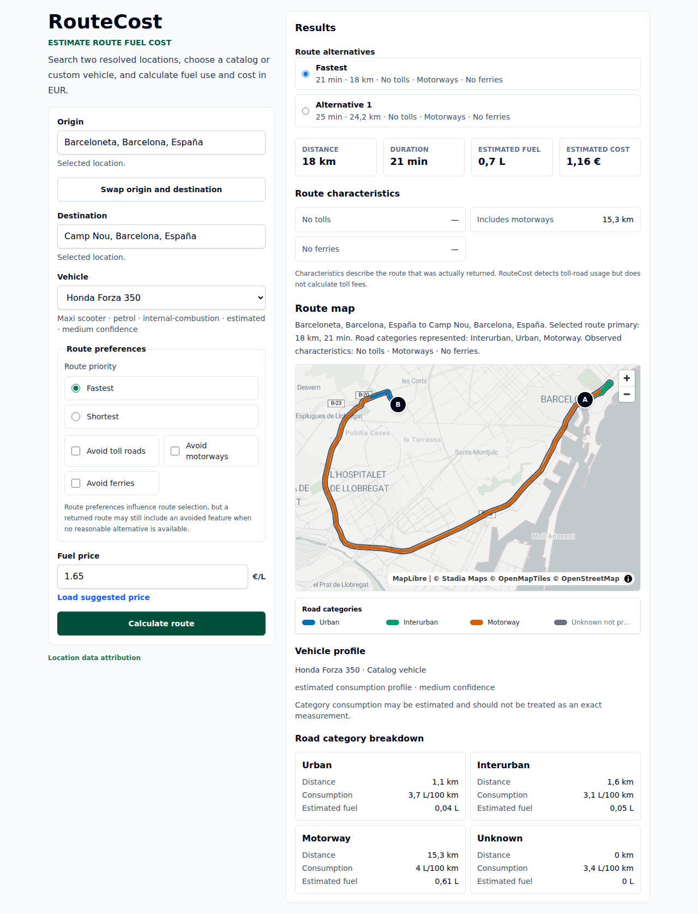
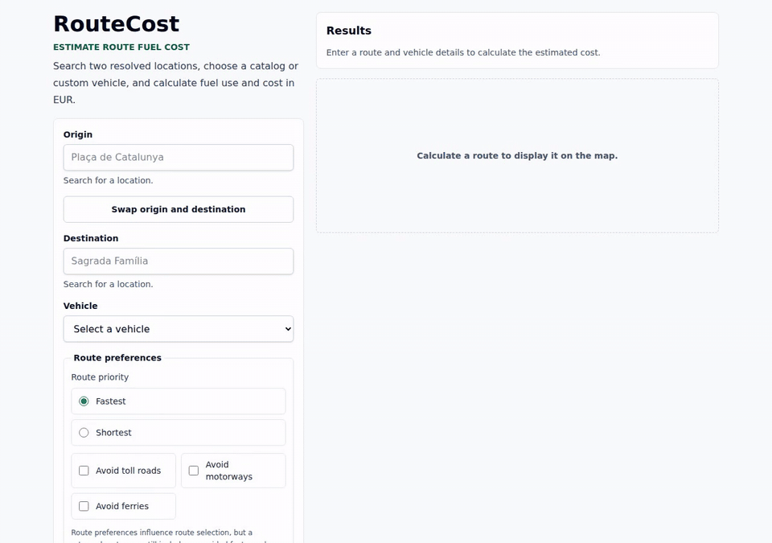

# RouteCost

RouteCost estimates the real cost of a vehicle route using route characteristics and vehicle-specific consumption data.

This repository is in its initial development phase. It contains a portable monorepo foundation, health checks, backend location search, routing-provider integration, route fuel/cost estimation, and a small static vehicle catalog.

The default providers are `mock`, so the whole stack starts with no API keys at all.

## Demo



End-to-end estimate flow recorded against the Stadia basemap and Valhalla routing: pick two Barcelona locations, choose the catalog Honda Forza 350, set the fuel price and read the distance, litres, cost, road-category breakdown and route map. The repository still defaults to the built-in `mock` providers and starts with no API keys.



The dynamic demo recording is also available as `docs/media/estimate-flow.mp4`.

## Requirements

- Node.js 26.12.1 (pinned in `.node-version` and `.nvmrc`)
- pnpm 10.34.3 (pinned in `packageManager`)
- Docker, optional

## Quick Start

```bash
npm i -g pnpm@10.34.3
pnpm install
pnpm run setup
pnpm dev
```

Open http://localhost:5173.

Frontend flow:

1. Select origin.
2. Select destination.
3. Select a catalog or custom vehicle.
4. Choose fastest or shortest.
5. Optionally avoid toll roads, motorways, or ferries.
6. Review the suggested nearby fuel price when available, or enter fuel price manually.
7. Calculate.
8. Review the actual characteristics of every alternative (tolls, motorways, ferries).
9. Check warnings when a preference could not be satisfied.
10. View route map and switch alternatives when available.

"Avoid" influences routing but is not an absolute guarantee: a returned route may still include an avoided feature when no reasonable alternative is available, and RouteCost reports the route that was actually returned. RouteCost detects toll-road usage but does not calculate toll fees.

The frontend flow is optimized mobile-first. Mock API providers are the default, so local development works without live routing or geocoding credentials.

Fuel-price suggestions use:

```text
origin coordinate
+ vehicle or fuel product
-> automatic country resolution
-> country provider lookup
-> nearby median price suggestion
```

Spain is currently supported. Other countries fall back to manual entry. The suggestion is a nearby median, not the cheapest guaranteed station price, and the fuel-price field remains editable. Manual values are not unexpectedly overwritten.

## Map Style Configuration

The route map uses MapLibre GL JS directly. Configure the browser-visible map style with:

```dotenv
VITE_MAP_STYLE_URL=<maplibre-compatible-style-url>
```

The default local value is `/map-style.json`, a deterministic blank style used for development and automated tests. Production should use a MapLibre-compatible style and tile source whose terms permit the intended public browser usage.

Do not reuse backend server secrets, Valhalla keys, or geocoding keys as frontend map tokens. Any value in `VITE_MAP_STYLE_URL` is exposed to the browser.

The route legend categories are:

```text
Urban
Interurban
Motorway
Unknown
```

## Local URLs

- Frontend: http://localhost:5173
- API: http://localhost:3001
- Swagger: http://localhost:3001/docs
- Health: http://localhost:3001/api/v1/health/ready

## Route Cost Estimates

`POST /api/v1/route-cost-estimates` calculates route alternatives through the configured routing provider, estimates litres by road category, and estimates fuel cost. It supports catalog mode with `vehicleId` and custom mode with `vehicleCategory` plus `consumptionProfile`. Consumption figures are example or catalog-estimated values unless their metadata says otherwise.

Requests may include provider-neutral route preferences:

```json
{
  "routePreferences": {
    "avoidTolls": true,
    "avoidMotorways": false,
    "avoidFerries": false,
    "priority": "fastest"
  }
}
```

`routePreferences` is optional and may be partially supplied; omitted fields resolve to `avoidTolls: false`, `avoidMotorways: false`, `avoidFerries: false`, `priority: "fastest"`. Requests without preferences keep the previous behavior. Avoidance is a routing preference, not an absolute guarantee.

Every response alternative includes the observed characteristics of the actual returned route (`tolls`, `motorways`, `ferries` with presence, distance, and segment count) and a `preferenceCompliance.conflicts` list such as `tolls-present` when an avoided feature is still present. The response also echoes the normalized applied `routePreferences`. Toll presence describes distance, never toll price.

Catalog mode:

```bash
curl \
  --request POST \
  --header "Content-Type: application/json" \
  --data '{
    "origin": {
      "latitude": 41.3902,
      "longitude": 2.154
    },
    "destination": {
      "latitude": 41.5912,
      "longitude": 1.5209
    },
    "vehicleId": "honda-forza-350-2025",
    "fuelPrice": {
      "amountPerLitre": 1.6,
      "currency": "EUR"
    },
    "alternatives": 1
  }' \
  http://localhost:3001/api/v1/route-cost-estimates
```

## Fuel Price Suggestions

`POST /api/v1/fuel-price-suggestions` suggests a nearby fuel price. Send either a catalog `vehicleId` or an explicit `fuelProduct`; do not send `countryCode`. The backend resolves the country from the coordinate.

```bash
curl \
  --request POST \
  --header "Content-Type: application/json" \
  --data '{
    "coordinate": {
      "latitude": 41.387,
      "longitude": 2.170
    },
    "vehicleId": "honda-forza-350-2025"
  }' \
  http://localhost:3001/api/v1/fuel-price-suggestions
```

Supported fuel products are `petrol-95-e5` and `diesel-a`. `FUEL_PRICE_PROVIDER_MODE=mock` requires no live source. `live` mode uses the official Spanish fuel-price REST JSON source and a process-local snapshot cache.

Custom mode:

```bash
curl \
  --request POST \
  --header "Content-Type: application/json" \
  --data '{
    "origin": {
      "latitude": 41.3902,
      "longitude": 2.154
    },
    "destination": {
      "latitude": 41.5912,
      "longitude": 1.5209
    },
    "vehicleCategory": "maxi-scooter",
    "consumptionProfile": {
      "urbanLitresPer100Km": 3.8,
      "interurbanLitresPer100Km": 3.0,
      "motorwayLitresPer100Km": 4.1,
      "unknownLitresPer100Km": 3.4
    },
    "fuelPrice": {
      "amountPerLitre": 1.6,
      "currency": "EUR"
    },
    "alternatives": 1
  }' \
  http://localhost:3001/api/v1/route-cost-estimates
```

## Vehicle Catalog

`@route-cost/vehicle-data` owns the static catalog data, validation, filtering, and provenance metadata. No database is required.

```bash
curl \
  "http://localhost:3001/api/v1/vehicles?vehicleCategory=maxi-scooter"
```

```bash
curl \
  "http://localhost:3001/api/v1/vehicles/honda-forza-350-2025"
```

## Location Search

Location search is backend-only. Autocomplete suggestions do not include coordinates; clients must call details after selecting a suggestion. Search and reverse geocoding return normalized coordinates directly. Provider IDs in examples are illustrative and may change.

Autocomplete:

```bash
curl \
  "http://localhost:3001/api/v1/locations/autocomplete?query=Pla%C3%A7a%20Cat&countryCode=ES&language=ca"
```

Search:

```bash
curl \
  "http://localhost:3001/api/v1/locations/search?query=Pla%C3%A7a%20de%20Catalunya%2C%20Barcelona&countryCode=ES&language=ca"
```

Details:

```bash
curl \
  --get \
  --data-urlencode "placeId=<provider-gid>" \
  --data-urlencode "language=ca" \
  "http://localhost:3001/api/v1/locations/details"
```

Reverse:

```bash
curl \
  "http://localhost:3001/api/v1/locations/reverse?latitude=41.387&longitude=2.170&language=ca"
```

Every response includes provider attribution:

```json
{
  "attribution": {
    "url": "https://stadiamaps.com/attribution/"
  }
}
```

Routing endpoints continue accepting coordinates rather than free-form address text.

## Scripts

- `pnpm dev`: run web, API, and watch builds through Turborepo
- `pnpm check`: format check, lint, typecheck, coverage tests, and build
- `pnpm test`, `pnpm test:coverage`, `pnpm test:integration`, `pnpm test:e2e`: run test layers
- `pnpm routing:verify`: manually verify the live Valhalla integration when `VALHALLA_API_KEY` is set
- `pnpm geocoding:verify`: manually verify the live Stadia geocoding integration when `STADIA_GEOCODING_API_KEY` is set
- `pnpm fuel-prices:verify:spain`: manually verify the live Spanish fuel-price source
- `pnpm docker:up`, `pnpm docker:smoke`, `pnpm docker:down`: build, smoke-test, and stop Compose

## Structure

- `apps/web`: React, Vite, Tailwind, TanStack Query web app
  - `src/pages/route-estimator`: first complete route-cost page
  - `src/features/location-search`: autocomplete and details resolution
  - `src/features/vehicle-selection`: API-backed native vehicle selection
  - `src/features/route-cost-form`: form request mapping and submission
  - `src/features/route-cost-results`: estimate rendering and alternatives
  - `src/features/route-map`: selected route visualization with MapLibre
  - `src/shared/components`: native primitives whose styling is intrinsic only
  - `src/shared/api`: native fetch client and typed API errors
- `apps/api`: NestJS API on Fastify
- `apps/e2e`: Playwright browser tests
- `packages/domain`: pure business logic
- `packages/contracts`: Zod HTTP contracts
- `packages/fuel-prices`: provider-neutral fuel-price models, registry, distance, nearby selection, and suggestion logic
- `packages/geocoding`: provider-neutral geocoding abstraction
- `packages/routing`: provider-neutral routing abstraction
- `packages/vehicle-data`: static curated vehicle catalog with provenance metadata

## Tests

```bash
pnpm format:check
pnpm lint
pnpm typecheck
pnpm test
pnpm test:coverage
pnpm test:integration
pnpm test:e2e
pnpm build
```

## Docker

```bash
pnpm docker:up
pnpm docker:smoke
pnpm docker:down
```

The Docker web app is exposed at http://localhost:8080 and proxies `/api/` to the API service.

## Environment Variables

`pnpm run setup` copies `.env.example` files only when a local `.env` does not already exist.

The mock provider is the default and requires no network access:

```dotenv
ROUTING_PROVIDER=mock
GEOCODING_PROVIDER=mock
```

The web map style is browser configuration and must be safe to expose:

```dotenv
VITE_MAP_STYLE_URL=/map-style.json
```

The Valhalla provider uses Stadia Maps EU and requires server-side credentials:

```dotenv
ROUTING_PROVIDER=valhalla
VALHALLA_API_KEY=<key>
```

The Stadia geocoding provider also uses the EU endpoint and keeps credentials server-side:

```dotenv
GEOCODING_PROVIDER=stadia
STADIA_GEOCODING_API_KEY=<key>
```

Review current Stadia Maps geocoding terms, account plan, and rate limits before a public production launch.

Automated tests never call the live provider. The only live API check introduced by this repository is manual:

```bash
ROUTING_PROVIDER=valhalla VALHALLA_API_KEY=<key> pnpm routing:verify
```

```bash
GEOCODING_PROVIDER=stadia \
STADIA_GEOCODING_API_KEY=<key> \
pnpm geocoding:verify search \
  --query "Plaça de Catalunya, Barcelona" \
  --country-code ES \
  --language ca
```

## Architecture

See [docs/architecture.md](docs/architecture.md) and [docs/decisions/0011-route-preferences-and-characteristics.md](docs/decisions/0011-route-preferences-and-characteristics.md). Turborepo remote cache can be added later with `TURBO_TOKEN` and `TURBO_TEAM`; CI does not require either variable.
